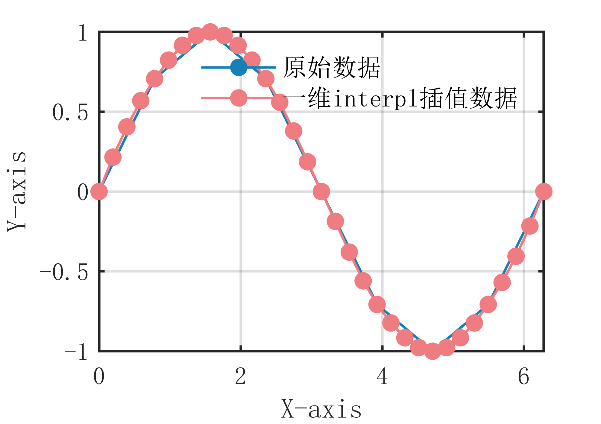

# MATLAB | Interpolation Algorithm | One-Dimensional Interpl Interpolation Method | Includes data and plotting code | Directly Useable

1. Basic Definition of One-Dimensional Interpolation Algorithm
The principle of the one-dimensional interpolation algorithm is to calculate the function value at any point by interpolating between known discrete data points. The specific algorithmic steps are as follows:
Input a set of known discrete data points, where  is the independent variable and  is the dependent variable.
Sort the data points based on their  values in ascending order.
For the given interpolation point , find the interval  such that .
Use the straight line between the known points to estimate the function value of the interpolation point , calculated according to the formula .
Output the function value of the interpolation point . The core idea of the one-dimensional interpolation algorithm is to perform linear interpolation between known data points, using the straight line between them to estimate the function value of an unknown point. The entire algorithm process is simple and intuitive, with fast computation speeds, making it suitable for some simple data interpolation problems.
2. Definition and Outline Effects
The outlining effects are as follows:
\n        \n      Attach video tutorial operation:
\n        \n          \n          \n          \n          \n            To view this video please enable JavaScript, and consider upgrading to a\n            web browser that\n            supports HTML5 video\n

## Images

<!-- PAYMENT_BLOCK -->

## Get this dataset

- Payment link (Stripe): [Buy now](https://buy.stripe.com/3cs8yP7sY87d0vu9AB)
- Payment QR code: 

<!-- /PAYMENT_BLOCK -->
